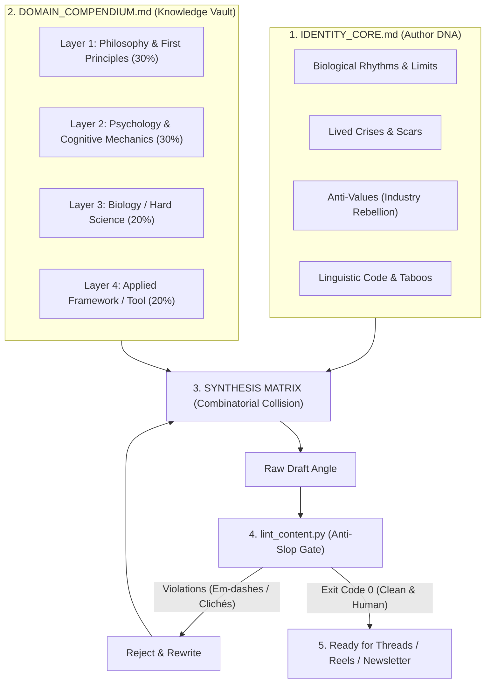

# 🏛️ Creator Core Engine

> **The Anti-Slop Content Operating System for AI Coding Agents and Human Creators.**  
> Transform AI from a generator of generic corporate slop into an authentic, deeply grounded extension of your real-world expertise.

[🇷🇺 Читать инструкцию на русском](README_RU.md) • [Templates](templates/) • [Examples](examples/) • [CLI Linter](tools/lint_content.py)

[](LICENSE)
[](tools/lint_content.py)
[](#architecture)

---

## 🚨 The Problem: The AI Content Crisis

99% of creators and founders use AI as a magic vending machine:
```
User: "Write me 10 Reel/Thread ideas for productivity"
AI:   "Sure! 1. Time-blocking is a game-changer! 2. Dive deep into waking up at 5 AM 👇..."
```

**Result:** Sterile, formulaic corporate noise. Readers immediately smell synthetic writing (em-dashes everywhere, clickbait down-arrows, fake enthusiasm, shallow listicles). Audience trust evaporates.

Why does this happen? **Because LLMs have no body, no biological limits, no personal scars, and no anti-values.** They generate from the average of the internet.

---

## ⚡ The Solution: The 4-Tier Architecture

**Creator Core Engine** stops AI from generating content out of thin air. Instead, content is synthesized from the collision between **the author's human limits** and **a curated 4-tier domain compendium**, strictly enforced by an automated anti-slop gate.



---

## 📦 What's Inside

| Component | Location | Purpose |
| :--- | :--- | :--- |
| **Agent Skills** | `.agents/skills/` | Pre-configured skills for Antigravity, Claude Code, and Cursor (`identity-extractor`, `compendium-builder`, `content-synthesizer`, `antislop-linter`). |
| **Templates** | `templates/` | Production-ready markdown blueprints for your identity DNA, domain vault, and synthesis matrix. |
| **CLI Linter** | `tools/lint_content.py` | Deterministic Python linter catching em-dashes, clickbait markers, and platform length limits. |
| **Living Examples** | `examples/` | Real-world implementations for a Systems Researcher and a Biotech/Health Specialist. |

---

## 🚀 Quickstart (5-Minute Setup)

### 1. Clone the repository
```bash
git clone https://github.com/voronin-s-dev/creator-core-engine.git
cd creator-core-engine
```

### 2. Extract Your Identity Core
Have your AI agent run the `identity-extractor` skill (or manually fill [templates/IDENTITY_CORE.template.md](templates/IDENTITY_CORE.template.md)):
* Document your real stamina limits (e.g. "90-minute sprinter, not an 8-hour marathoner").
* List 3-5 authentic career mistakes or burnout episodes.
* Define what you hate hearing in your industry (your anti-values).

### 3. Build Your Domain Compendium
Fill [templates/DOMAIN_COMPENDIUM.template.md](templates/DOMAIN_COMPENDIUM.template.md) with 3-4 foundational disciplines rather than surface-level tips:
* **Philosophy:** Stoicism, Non-duality, Epistemology.
* **Psychology:** Internal Family Systems, Jungian Shadow, Behavioral Economics.
* **Biology / Science:** Ultradian rhythms, Dopamine baseline, Endocrinology.
* **Your Tool:** Your proprietary framework or method.

### 4. Synthesize Content
Prompt your agent:
> *"Using `IDENTITY_CORE.md` and `DOMAIN_COMPENDIUM.md`, synthesize 3 content angles that collide [Model X from Layer 1] with [Limit Y from Layer 3]. Run all drafts through `tools/lint_content.py` before presenting."*

---

## 🔬 The Anti-Slop Gatekeeper (`lint_content.py`)

Every post generated by this engine must pass automated inspection:

```bash
python tools/lint_content.py path/to/draft.md --max-len 500
```

### What It Catches Mechanically:
* ❌ **Em-dashes (`—`):** Forbidden in short-form social copy. The #1 cadence tell of ChatGPT/Claude.
* ❌ **Clickbait Cliches:** *"Знакомо чувство?", "Тред о том, почему... 👇", "Dive deep", "Game-changer"*.
* ❌ **Pompous Buzzwords:** *"квантовый", "план на миллион", "сервер IBM", "сверхмощный"*.
* ❌ **Premature Cold-Start CTAs:** Hard-selling or lead-magnet harvesting in introductory brand posts.
* ❌ **Platform Limits:** Strictly validates characters against network constraints (e.g. 500 chars for Threads).

---

## 📚 Real-World Comparison

| Scenario | Generic AI Generation | Creator Core Engine Synthesis |
| :--- | :--- | :--- |
| **Productivity / Burnout** | *"5 time-management hacks you need to know! Use the Pomodoro technique to supercharge your hustle 👇"* | *"Долго не мог понять, почему после пары часов работы меня выключает, хотя планов полно. Дело не в дисциплине: скорость мышления не совпадает с емкостью тела..."* |
| **Health / Dieting** | *"Why 95% of diets fail! The secret metabolism booster that will change your fitness journey forever 👇"* | *"Четыре года я считал калории до грамма и бегал 6 раз в неделю. Итог: упавший ферритин и плато. Тело не калькулятор, а адаптивная гормональная система..."* |

---

## 🛠️ Multi-Agent Compatibility

* **Google Antigravity**: Supported natively via [GEMINI.md](GEMINI.md) and `.agents/skills/`.
* **Claude Code**: Supported via [CLAUDE.md](CLAUDE.md).
* **Cursor / Windsurf**: Supported via [AGENTS.md](AGENTS.md).

---

## 👤 Author

Developed by **Sergey Voronin** ([@harmonious_thinker](https://t.me/harmonious_thinker)).  
Systems researcher, developer, and author exploring the intersection of consciousness, cognitive mechanics, and human operating systems.

---

## 📄 License

Distributed under the **MIT License**. See [LICENSE](LICENSE) for full details.
