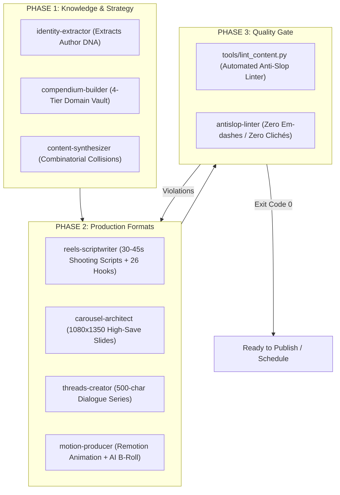

# 🏛️ Creator Core Engine

> **The Full-Stack Anti-Slop Content Operating System for AI Coding Agents and Human Creators.**  
> Transform AI from a generator of generic corporate noise into an end-to-end studio: from authentic identity extraction to 30-45s Reels scripts, high-save carousels, and verified viral threads.

[🇷🇺 Читать инструкцию на русском](README_RU.md) • [Templates](templates/) • [Examples](examples/) • [CLI Linter](tools/lint_content.py)

[](LICENSE)
[](tools/lint_content.py)
[](#architecture)

---

## 🚨 The Problem: The AI Content Crisis

99% of creators and founders use AI as a magic vending machine:
```
User: "Write me 10 Reel/Thread ideas for productivity"
AI:   "Sure! 1. Time-blocking is a game-changer! 2. Dive deep into waking up at 5 AM 👇..."
```

**Result:** Sterile, formulaic corporate noise. Readers immediately smell synthetic writing (em-dashes everywhere, clickbait down-arrows, fake enthusiasm, shallow listicles). Audience trust evaporates.

Why does this happen? **Because LLMs have no body, no biological limits, no personal scars, and no anti-values.** They generate from the average of the internet.

---

## ⚡ The Solution: The 3-Phase Content Studio

**Creator Core Engine** stops AI from generating content out of thin air. Instead, it operates as a full-stack media team divided into three coordinated phases:



---

## 📦 What's Inside

### 1. Agent Skills (`.agents/skills/`)
| Skill | Phase | Description |
| :--- | :--- | :--- |
| **`creator-core`** | Master | Main orchestrator routing requests across all subagents. |
| **`identity-extractor`** | Strategy | Conducts a 15-minute diagnostic interview to extract your human limits and scars. |
| **`compendium-builder`** | Strategy | Maps 4 foundational domain layers (Philosophy, Psychology, Science, Tool). |
| **`content-synthesizer`** | Strategy | Collides identity limits with domain models to produce non-obvious angles. |
| **`reels-scriptwriter`** | Production | Generates 30-45s vertical video scripts, teleprompter voiceover, and SEO captions. |
| **`carousel-architect`** | Production | Designs 10-slide 1080×1350 carousels structured for maximal Saves and Shares. |
| **`threads-creator`** | Production | Writes conversational threads and daily fillers under 500 characters. |
| **`motion-producer`** | Production | Tri-modal Remotion animation with Kowalski spring physics and AI B-roll. |
| **`antislop-linter`** | Gate | Automated quality assurance blocking em-dashes, corporate slop, and bad CTAs. |

### 2. Blueprints & Templates (`templates/`)
* **`IDENTITY_CORE.template.md`**: Template for author constraints, values, and voice code.
* **`DOMAIN_COMPENDIUM.template.md`**: 4-tier knowledge vault architecture.
* **`SYNTHESIS_MATRIX.template.md`**: Combinatorial idea generation matrix.
* **`HOOKS_VAULT_26.md`**: 26 battle-tested viral hook formulas across 5 categories.
* **`REELS_SCRIPT.template.md`**: 30-45s shooting script with teleprompter and timing breakdown.
* **`CAROUSEL.template.md`**: Slide-by-slide 1080×1350 carousel blueprint.
* **`CONTENT_REGISTRY.template.md`**: Memory bank for published/planned content and facet balance.

### 3. Verification Code (`tools/`)
* **`tools/lint_content.py`**: Standalone Python 3.10+ linter (zero dependencies).
* **`tools/test_linter.py`**: Unit test suite verifying all anti-slop rules.

---

## 🚀 Quickstart: Run Your Content Studio in 4 Steps

### 1. Clone the repository
```bash
git clone https://github.com/voronin-s-dev/creator-core-engine.git
cd creator-core-engine
```

### 2. Extract Your Identity Core
Ask your AI agent:
> *"Run the `identity-extractor` skill. Interview me on my real working limits, past failures, and industry pet peeves, then fill `IDENTITY_CORE.md`."*

### 3. Build Your Domain Compendium
Ask your AI agent:
> *"Run `compendium-builder`. Help me organize my domain knowledge into 4 fundamental layers (Philosophy, Psychology, Science, Tool)."*

### 4. Produce High-Retention Formats
* **For Reels:** *"Using `reels-scriptwriter`, turn concept [X] into a 35-second shooting script with teleprompter text and a hook from `HOOKS_VAULT_26.md`."*
* **For Carousels:** *"Using `carousel-architect`, create a 10-slide 1080x1350 carousel on topic [Y] focused on saves."*
* **For Threads:** *"Using `threads-creator`, write a 3-post thread under 500 chars per post, and validate via `tools/lint_content.py`."*

---

## 🔬 The Anti-Slop Gatekeeper (`lint_content.py`)

Every piece of copy must pass automated CLI inspection:
```bash
python tools/lint_content.py path/to/draft.md --max-len 500
```

### What It Catches Mechanically:
* ❌ **Em-dashes (`—`):** Forbidden in short-form copy. The #1 tell of ChatGPT/Claude.
* ❌ **Clickbait Clichés:** *"Знакомо чувство?", "Тред о том, почему... 👇", "Dive deep", "Game-changer"*.
* ❌ **Pompous Buzzwords:** *"квантовый", "план на миллион", "сервер IBM", "сверхмощный"*.
* ❌ **Premature Cold-Start CTAs:** Hard-selling or lead-magnet harvesting in introductory brand posts.
* ❌ **Platform Limits:** Strictly validates characters against network constraints (e.g. 500 chars for Threads).

---

## 🛠️ Multi-Agent Compatibility

* **Google Antigravity**: Supported natively via [GEMINI.md](GEMINI.md) and `.agents/skills/`.
* **Claude Code**: Supported via [CLAUDE.md](CLAUDE.md).
* **Cursor / Windsurf**: Supported via [AGENTS.md](AGENTS.md).
* **ChatGPT / Claude Web**: Upload `IDENTITY_CORE.md` and `DOMAIN_COMPENDIUM.md` to Project Knowledge.

---

## 👤 Author

Developed by **Sergey Voronin** ([@harmonious_thinker](https://t.me/harmonious_thinker)).  
* Telegram Channel: [@harmonious_thinker_space](https://t.me/harmonious_thinker_space)  
* Systems researcher, developer, and author exploring the intersection of consciousness, cognitive mechanics, and human operating systems.

---

## 📄 License

Distributed under the **MIT License**. See [LICENSE](LICENSE) for full details.
