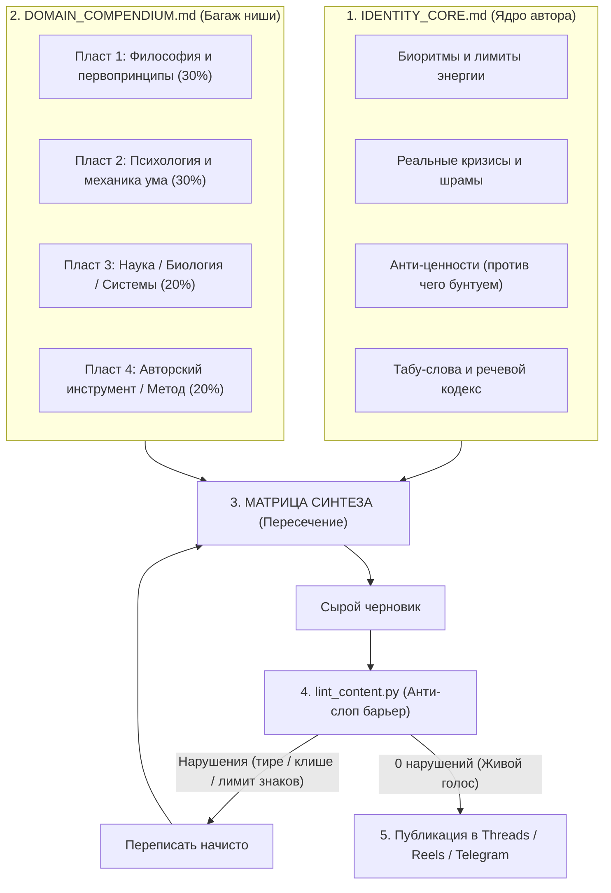

# 🏛️ Creator Core Engine (Инструкция на русском)

> **Анти-слоп контентная операционная система для ИИ-агентов и авторов.**  
> Превращает ИИ из генератора безликих текстов в продолжение вашего реального экспертного опыта.

[English Version](README.md) • [Шаблоны](templates/) • [Примеры](examples/) • [CLI-линтер](tools/lint_content.py)

---

## 🚨 В чем главная проблема ИИ-контента

99% экспертов используют ChatGPT или Claude как «волшебную кнопку»:
```
Пользователь: «Напиши мне 10 идей для постов про продуктивность»
ИИ: «Конечно! 1. Тайм-менеджмент — настоящий game-changer! Давайте разберемся 👇...»
```

**Результат:** Мертворожденный, пластиковый текст. Читатели моментально считывают повадки нейросети:
* Длинные тире (`—`) почти в каждом предложении;
* Дешевые заходы («Знакомо чувство?», «Тред о том, почему... 👇»);
* Псевдонаучные словечки («квантовый», «сервер IBM», «план на миллион»);
* Банальные списки очевидных истин из Википедии.

**Почему так происходит?**  
У языковой модели нет тела, нет физической усталости, нет профессиональных кризисов и нет личных анти-ценностей. Она генерирует среднее арифметическое по интернету.

---

## ⚡ Архитектура решения: «Ядро + Компендиум»

**Creator Core Engine** запрещает ИИ придумывать темы из пустоты. Контент создается на **стыке трех опорных точек**:

$$\text{Идея поста} = [\text{Ограничение или шрам из Ядра}] \times [\text{Модель из Компендиума}] \times [\text{Заблуждение ниши}]$$



---

## 📋 Пошаговая инструкция запуска (4 шага)

### Шаг 1. Распакуйте свое «Ядро Личности» (`IDENTITY_CORE.md`)

Скопируйте шаблон [`templates/IDENTITY_CORE.template.md`](templates/IDENTITY_CORE.template.md) в корень своего проекта и переименуйте в `IDENTITY_CORE.md`.

Если вы работаете с ИИ-агентом (Antigravity, Claude Code, Cursor), просто отправьте ему промпт:

> 💬 **Промпт для агента:**  
> *«Запусти скилл identity-extractor. Задай мне по очереди 5 вопросов про мои реальные рабочие лимиты, прошлые ошибки, анти-ценности в моей нише и табу-слова. По моим ответам заполни файл IDENTITY_CORE.md»*.

**Что обязательно должно быть в ядре:**
* **Реальные ограничения:** Вы спринтер (90 минут работы) или марафонец? Во сколько выключается голова?
* **Шрамы и кризисы:** 2–3 настоящих факапа, через которые вы прошли (выгорание, слитый бюджет, плохой найм).
* **Анти-ценности:** Что вас откровенно бесит в вашей профессии? Против каких советов масс-маркета вы выступаете?
* **Табу-слова:** Список слов, которые вы никогда не скажете в жизни.

---

### Шаг 2. Соберите 4-слойный Компендиум ниши (`DOMAIN_COMPENDIUM.md`)

Не собирайте банальные советы. Соберите **библиотеку первоисточников** через шаблон [`templates/DOMAIN_COMPENDIUM.template.md`](templates/DOMAIN_COMPENDIUM.template.md).

> 💬 **Промпт для агента:**  
> *«Помоги мне собрать DOMAIN_COMPENDIUM.md по моей нише [назовите тему]. Разбей первоисточники строго на 4 пласта: 1) Философия и этика (30%), 2) Психология и когнитивные искажения (30%), 3) Биология, физиология или точные системы (20%), 4) Мой прикладной инструмент (20%). Никакой поверхностной воды — только фундаментальные концепции и авторы»*.

#### Пример структуры для ниши IT / Разработки:
1. **Пласт 1 (Философия):** Стоицизм (дихотомия контроля), бритва Оккама, этика ремесленника.
2. **Пласт 2 (Психология):** Синдром самозванца, когнитивная перегрузка (Cognitive Load Theory), петли стресса.
3. **Пласт 3 (Системы):** Теория ограничений Голдратта, закон Конвея, нейробиология фокуса.
4. **Пласт 4 (Инструмент):** Чистая архитектура, TDD, CI/CD пайплайны.

---

### Шаг 3. Синтезируйте темы без высасывания из пальца

Когда оба файла созданы, темы создаются по формуле перекрестного опыления:

> 💬 **Промпт для агента:**  
> *«Используя мои файлы IDENTITY_CORE.md и DOMAIN_COMPENDIUM.md, сгенерируй 3 идеи постов. Каждая идея должна строиться на столкновении [Модели из Пласта 1 или 2] с [Моим реальным ограничением из Ядра] и разбивать популярный миф в моей нише. Перед выводом обязательно проверь текст через tools/lint_content.py»*.

---

### Шаг 4. Прогоните текст через Анти-слоп линтер

В репозитории есть готовый скрипт проверки [`tools/lint_content.py`](tools/lint_content.py) (работает на чистом Python 3.10+ без сторонних библиотек).

Запуск из консоли:
```bash
python tools/lint_content.py путь_к_файлу.md --max-len 500
```
Или проверка строки напрямую:
```bash
python tools/lint_content.py --text "Текст вашего поста..." --first-post
```

**Что скрипт отлавливает на корню:**
* ❌ Длинные тире (`—`) — главный маркер текста нейросети.
* ❌ Стрелочки вниз (`👇`) и кликбейтные смайлики.
* ❌ Шаблонные фразы («Знакомо чувство?», «Тред о том, почему...»).
* ❌ Пафосные штампы («квантовый», «сервер IBM», «план на миллион», «game-changer»).
* ❌ Прямые продажи и зазывы в воронку в ознакомительных постах.
* ❌ Превышение лимита символов (например, 500 знаков для Threads).

---

## 🛠️ Как подключить к разным инструментам

### В Google Antigravity:
Папка `.agents/skills` уже содержит все манифесты скиллов. Просто добавьте репозиторий как воркспейс или используйте скиллы из чата.

### В Claude Code:
Файл [`CLAUDE.md`](CLAUDE.md) автоматически задает правила проверки при каждом обращении к кодовой базе.

### В Cursor / Windsurf:
Файл [`AGENTS.md`](AGENTS.md) считывается контекстными окнами IDE.

### В обычном веб-интерфейсе ChatGPT / Claude:
1. Загрузите ваши заполненные файлы `IDENTITY_CORE.md` и `DOMAIN_COMPENDIUM.md` в раздел «Project Knowledge» (в Claude) или прикрепите к диалогу.
2. В системный промпт (Custom Instructions) вставьте текст из [AGENTS.md](AGENTS.md).

---

## 📖 Живые примеры в репозитории

Посмотрите, как устроены готовые связки:
* [`examples/01_systems_researcher/`](examples/01_systems_researcher/) — кейс системного исследователя и разработчика (философия + психология ума + матрица).
* [`examples/02_biotech_health/`](examples/02_biotech_health/) — кейс специалиста по здоровью и метаболизму (Талеб + эндокринология + отказ от диет).

---

## 📄 Лицензия и авторство

Разработано **Сергеем Ворониным** ([@harmonious_thinker](https://t.me/harmonious_thinker)).  
Проект распространяется под открытой лицензией **MIT License**.
