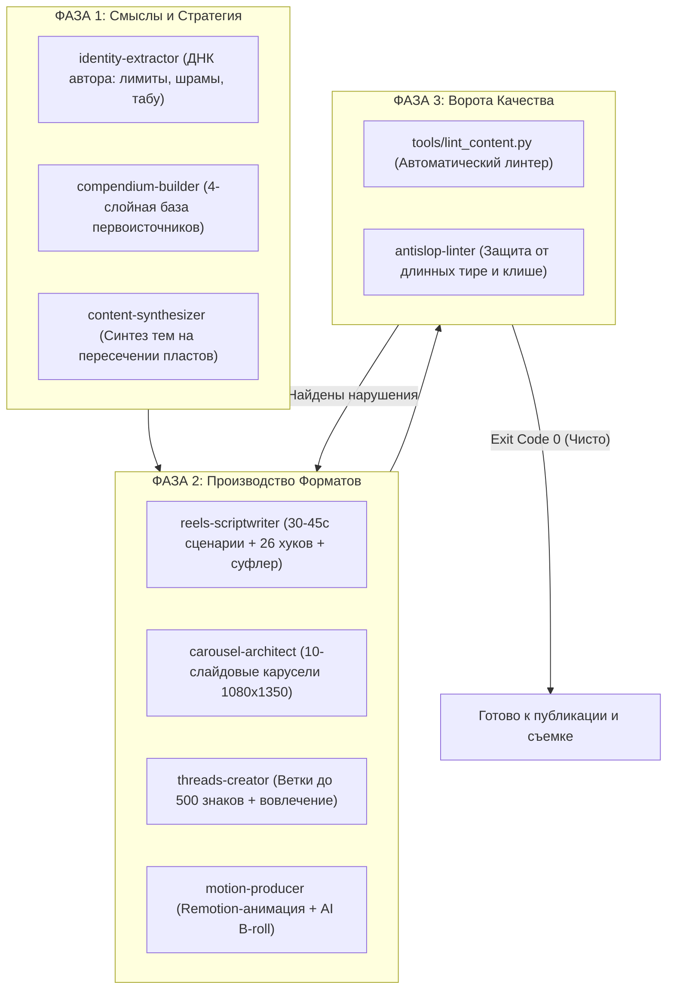

# 🏛️ Creator Core Engine (Инструкция на русском)

> **Полноценная анти-слоп контентная студия для ИИ-агентов и авторов.**  
> Превращает ИИ из генератора пластиковых текстов в полноценную команду: от распаковки живого опыта до съемочных сценариев Reels, вирусных каруселей и веток Threads без единого грамма нейросетевого мусора.

[English Version](README.md) • [Шаблоны](templates/) • [Примеры](examples/) • [CLI-линтер](tools/lint_content.py)

---

## 🚨 В чем главная проблема ИИ-контента

99% экспертов используют ChatGPT или Claude как «волшебную кнопку»:
```
Пользователь: «Напиши мне 10 идей для рилс про продуктивность»
ИИ: «Конечно! 1. Тайм-менеджмент — настоящий game-changer! Давайте разберемся 👇...»
```

**Результат:** Мертворожденный, шаблонный шум. Читатели моментально считывают фальшивку:
* Длинные тире (`—`) почти в каждом предложении;
* Дешевые кликбейтные стрелочки (`👇`) и заезженные заходы («Знакомо чувство?», «Тред о том...»);
* Псевдонаучный пафос («квантовый», «сервер IBM», «план на миллион»);
* Банальные советы уровня Википедии.

**Почему так происходит?**  
У языковой модели нет тела, нет усталости, нет реальных шрамов и нет анти-ценностей. Она генерирует среднее арифметическое по интернету.

---

## ⚡ Архитектура решения: Трехфазная Контент-Студия

**Creator Core Engine** организует работу ИИ как слаженную редакцию из трех взаимосвязанных фаз:



---

## 📦 Что входит в репозиторий

### 1. Набор агентских скиллов (`.agents/skills/`)
| Скилл | Фаза | Что делает |
| :--- | :--- | :--- |
| **`creator-core`** | Мастер | Главный оркестратор: направляет задачи нужным агентам. |
| **`identity-extractor`** | Смыслы | Проводит 15-минутное интервью с автором и собирает его ДНК. |
| **`compendium-builder`** | Смыслы | Упаковывает нишу в 4 глубоких пласта (Философия, Психология, Наука, Метод). |
| **`content-synthesizer`** | Смыслы | Высекает контринтуитивные идеи на стыке личного опыта и моделей. |
| **`reels-scriptwriter`** | Форматы | Пишет 30–45с съемочные сценарии для Reels/Shorts с раскадровкой и текстом для суфлера. |
| **`carousel-architect`** | Форматы | Проектирует 10-слайдовые карусели 1080×1350 под максимальные сохранения (Saves). |
| **`threads-creator`** | Форматы | Пишет живые ветки и посты для Threads и X с лимитом до 500 символов. |
| **`motion-producer`** | Продакшн | Собирает Remotion-анимации с пружинной физикой Ковальски и генерирует B-roll. |
| **`antislop-linter`** | Контроль | Автоматически срезает длинные тире, ИИ-штампы и агрессивные продажи. |

### 2. Готовые шаблоны (`templates/`)
* **`IDENTITY_CORE.template.md`**: Шаблон ДНК автора (психофизика, реальные ритмы, шрамы, табу).
* **`DOMAIN_COMPENDIUM.template.md`**: Структура 4-слойной базы знаний ниши.
* **`SYNTHESIS_MATRIX.template.md`**: Формула комбинаторного пересечения пластов.
* **`HOOKS_VAULT_26.md`**: Каталог из **26 проверенных вирусных хуков** по 5 категориям.
* **`REELS_SCRIPT.template.md`**: Технический сценарий ролика (тайминги, визуал, текст на экране, суфлер).
* **`CAROUSEL.template.md`**: Послайдовый чертеж экспертной карусели 1080×1350.
* **`CONTENT_REGISTRY.template.md`**: Реестр вышедших и запланированных постов с трекером баланса.

### 3. Автоматика проверки (`tools/`)
* **`tools/lint_content.py`**: Автономный CLI-линтер на чистом Python 3.10+ (без внешних библиотек).
* **`tools/test_linter.py`**: Набор модульных тестов, гарантирующий работу всех анти-слоп правил.

---

## 🚀 Пошаговый запуск контентной студии (4 шага)

### Шаг 1. Клонируйте репозиторий
```bash
git clone https://github.com/voronin-s-dev/creator-core-engine.git
cd creator-core-engine
```

### Шаг 2. Распакуйте ДНК автора (`IDENTITY_CORE.md`)
Отправьте агенту в чат:
> 💬 **Промпт:**  
> *«Запусти скилл identity-extractor. Задай мне по очереди 5 вопросов про мои биоритмы, реальные лимиты энергии, прошлые факапы, анти-ценности в моей нише и табу-слова. По моим ответам заполни файл IDENTITY_CORE.md»*.

### Шаг 3. Соберите компендиум первоисточников (`DOMAIN_COMPENDIUM.md`)
Отправьте агенту:
> 💬 **Промпт:**  
> *«Запусти скилл compendium-builder. Помоги структурировать знания по моей нише [назовите тему] на 4 пласта: Философия (30%), Психология (30%), Наука/Системы (20%), Мой авторский метод (20%). Отбирай только глубокие фундаментальные концепции и авторов»*.

### Шаг 4. Заказывайте конкретные форматы

#### Для сценариев Reels / Shorts (30–45 секунд):
> 💬 **Промпт:**  
> *«Используя скилл reels-scriptwriter, напиши съемочный сценарий на тему [назовите тему]. Выбери хук из HOOKS_VAULT_26.md, сделай посекундную раскадровку (визуал, титры, суфлер) и подготовь SEO-описание. Перед выводом прогони текст через tools/lint_content.py»*.

#### Для экспертных каруселей (Instagram / LinkedIn):
> 💬 **Промпт:**  
> *«Используя скилл carousel-architect, спроектируй 10-слайдовую карусель 1080х1350 по теме [назовите тему] с фокусом на сохранения. На каждом слайде не более 40 слов, структура: проблема -> механизм -> пошаговый протокол»*.

#### Для веток Threads / Twitter:
> 💬 **Промпт:**  
> *«Используя скилл threads-creator, напиши тред из 3 связанных сообщений. Каждый блок строго до 500 знаков, спокойный исследовательский тон, открытый вопрос в конце. Проверь через tools/lint_content.py»*.

---

## 🔬 Анти-слоп барьер (`lint_content.py`)

Каждый текст перед показом или публикацией обязан пройти машинный аудит:

```bash
python tools/lint_content.py путь_к_файлу.md --max-len 500
```

### Что скрипт отлавливает на корню:
* ❌ **Длинные тире (`—`):** Главный синтаксический маркер ChatGPT/Claude.
* ❌ **Кликбейтные клише:** *«Знакомо чувство?», «Тред о том, почему... 👇», «Dive deep», «Game-changer»*.
* ❌ **Пафосные штампы:** *«квантовый», «план на миллион», «сервер IBM», «сверхмощный»*.
* ❌ **Преждевременные продажи:** Зазывы на консультации и лид-магниты в холодных ознакомительных постах.
* ❌ **Превышение лимита платформы:** Следит за ограничением в 500 символов для одного поста в Threads.

---

## 🛠️ Совместимость с ИИ-средами

* **Google Antigravity**: Папка `.agents/skills/` подключается нативно; правила в [`GEMINI.md`](GEMINI.md).
* **Claude Code**: Поддерживается через [`CLAUDE.md`](CLAUDE.md).
* **Cursor / Windsurf**: Поддерживается через [`AGENTS.md`](AGENTS.md).
* **Веб-версии ChatGPT / Claude**: Загрузите файлы `IDENTITY_CORE.md` и `DOMAIN_COMPENDIUM.md` в раздел «Project Knowledge» и скопируйте текст [AGENTS.md](AGENTS.md) в системный промпт.

---

## 👤 Автор

Разработано **Сергеем Ворониным** ([@harmonious_thinker](https://t.me/harmonious_thinker)).  
* Авторский Telegram-канал: [@harmonious_thinker_space](https://t.me/harmonious_thinker_space)  
* Исследователь систем сознания, разработчик и автор платформы глубокого анализа личности.

---

## 📄 Лицензия

Распространяется под свободной лицензией **MIT License**. См. [LICENSE](LICENSE).
